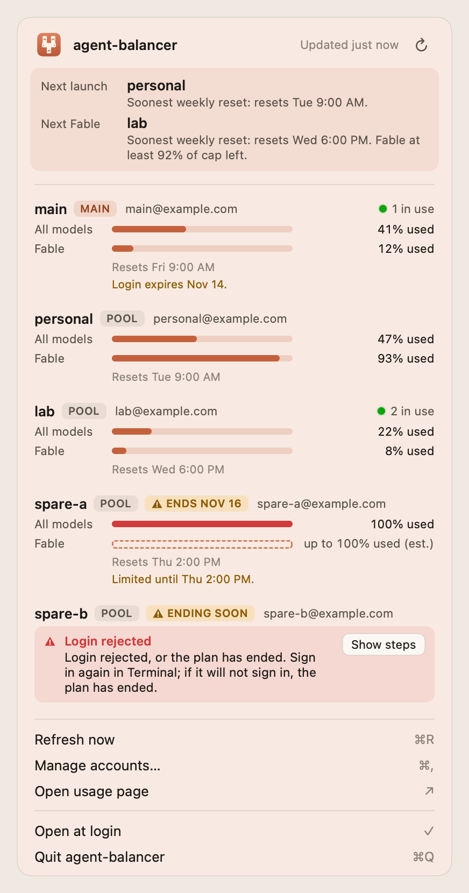
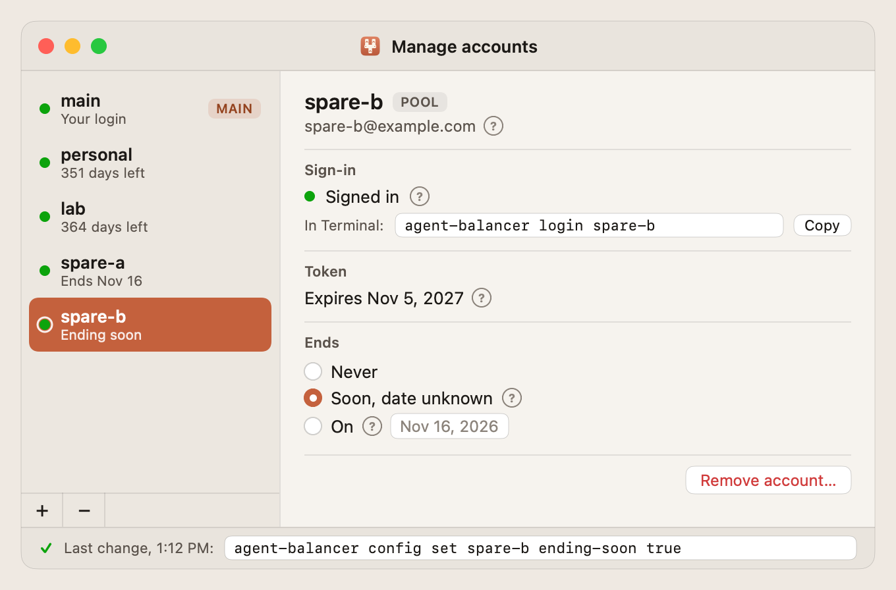
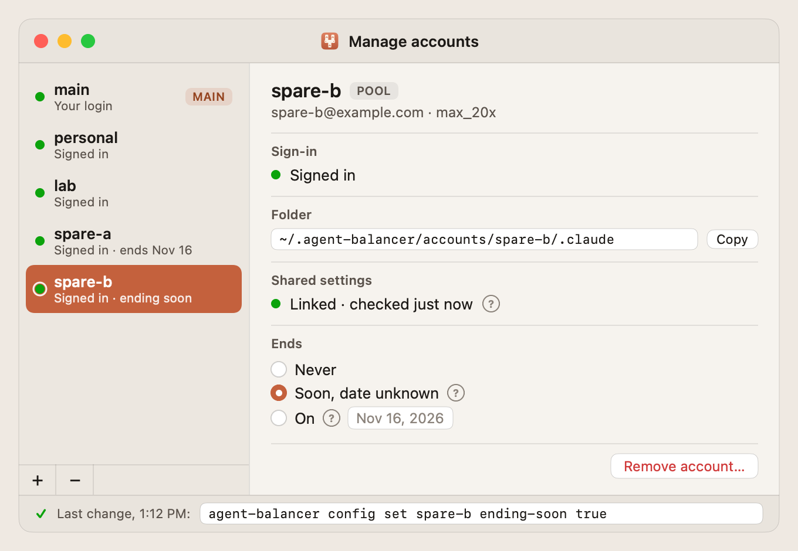

# agent-balancer

agent-balancer reads how much of each Claude Code subscription you have used and picks the account for your next launch, spending first the room that resets soonest.

<picture>
  <source media="(prefers-color-scheme: dark)" srcset="docs/media/menu-dark.png">
  
</picture>

<picture>
  <source media="(prefers-color-scheme: dark)" srcset="docs/media/manage-tokens-dark.png">
  
</picture>

<picture>
  <source media="(prefers-color-scheme: dark)" srcset="docs/media/manage-folders-dark.png">
  
</picture>

## Requirements

- macOS 14 or later on Apple silicon.
- Claude Code, signed in on the account you want to use as your first account, at
  `~/.local/bin/claude`, `/opt/homebrew/bin/claude` or `/usr/local/bin/claude`. The tool looks
  for `claude` only in those three places and reads no path to it from its own files; if yours
  is elsewhere, link it into `~/.local/bin`. The file must be owned by you or root and not
  writable by group or others, and when it is in `~/.local/bin`, so must that folder.
- Two or more Claude subscription accounts to spread work across.

## Install

1. Install the command line tool with Homebrew:

   ```
   brew install <user>/tap/agent-balancer
   ```

2. Download `AgentBalancerBar.zip` from the latest GitHub release and check it:

   ```
   gh attestation verify AgentBalancerBar.zip --repo <user>/agent-balancer
   ```

3. Unzip it and drag `AgentBalancerBar.app` to Applications.
4. The app is not signed yet, so macOS stops its first open. On macOS 14 that open takes four
   steps (newer versions may word them differently):
   1. Open the app. macOS says it cannot open it and shows only an OK button. Choose OK.
   2. Open System Settings, then Privacy & Security. Under Security, below the line that says
      "AgentBalancerBar" was blocked from use, choose Open Anyway.
   3. Enter an administrator's password when asked, and choose Modify Settings.
   4. macOS asks whether you are sure you want to open it. Choose Open.

   Do these four steps again after each upgrade until the app is signed.

Upgrade the tool with `brew upgrade agent-balancer` and replace the app from the new zip.

## First five minutes

1. `agent-balancer init --label <label>` registers the account that Claude Code is signed in to.
2. `agent-balancer refresh` reads its usage and `agent-balancer status` shows it. Open the app:
   your first account shows at once.
3. Add each further account and sign it in. A token account is the default kind:

   ```
   agent-balancer add <label> [--ends YYYY-MM-DD | --ending-soon]
   agent-balancer login <label>
   ```

   An account keeps one end marker: its last day with
   `agent-balancer add <label> --ends YYYY-MM-DD` (a real day, today or later), ending soon with
   `agent-balancer add <label> --ending-soon` when the day is not known, or neither.
   `agent-balancer login <label>` runs `claude setup-token` in Terminal, takes the token without
   showing it and saves it. Approve the token in the browser as the account you are adding: the
   tool does not check which account a token belongs to.
   `agent-balancer login <label> --paste` is the fallback: you run `claude setup-token` and paste
   the token at a prompt that does not echo it.
4. `agent-balancer status` shows the new account with its first reading.
5. For an account that needs your full login with connectors, add a folder account instead. Read
   the dry run's list of links, then apply it, typing the label back when asked, and sign the
   folder in:

   ```
   agent-balancer add <label> --kind folder --email <address>
   agent-balancer link <label> --dry-run
   agent-balancer link <label>
   agent-balancer login <label>
   ```

   **One account per folder, for good.** A folder stays on the account it was first signed in
   to. Saved thinking from current models works only in the account that produced it, and a
   chat that meets a second sign-in loses it (see
   [preserved thinking](https://platform.claude.com/docs/en/build-with-claude/preserved-thinking)).
   Never sign a different account into a folder that already has chats. Add a new folder for
   the new account instead.
6. Optional: `agent-balancer config set-main <label>` protects the account you work on yourself.
   No account is protected until you name one.
7. Link the skill file into your skills folder so your own Claude knows how to pick an account.
   Run this yourself; the tool never writes inside `~/.claude`:

   ```
   mkdir -p ~/.claude/skills && ln -s "$(brew --prefix)/share/agent-balancer/skill/agent-balancer" ~/.claude/skills/agent-balancer
   ```

## How it picks

1. It skips an account that is ended, limited or in error. A login or folder account is in error,
   for example, when a sign-in check finds it signed out, or signed in as another email or on
   another plan than the tool expects. A token account is in error, for example, when its token
   file is missing or unusable; its email is a note that is never checked.
2. It keeps accounts with enough room in the weekly window (and the five-hour window when there is
   one). For a Fable launch, it also needs room in the Fable allowance.
3. The main account has a reserve: it is eligible only while its weekly use stays under a line
   that rises as its weekly reset gets closer, so less of its week is held back for you.
4. Among the rest, the account whose use resets soonest goes first, because its unused room is
   about to be lost. An account with an end date ranks by that date when it is sooner, and one
   marked as ending soon ranks as if it ended `picker.endingSoonAssumeDays` days from now (2 by
   default).
5. If nothing fits, it says so and picks nothing.

## How it works

- `agent-balancer refresh` reads each account's usage with a one-turn probe, skipping a reading
  that is still fresh, and stores the usage that `claude` reports as a percent from 0 to 100.
  `agent-balancer pick` refreshes readings that are too old, then returns a recipe: the
  environment and arguments to launch `claude` with.
- `agent-balancer run <label>` starts Claude Code on one account for you. Programs and skills
  call `agent-balancer pick --json` before every launch. The calling rules are in
  [docs/CONTRACT.md](docs/CONTRACT.md).
- `agent-balancer status`, `agent-balancer events` and `agent-balancer history` show state, what
  changed and readings over time. The menu bar app shows the same state, writes no file in
  normal use and makes every account change by running `agent-balancer`.
- Other tools also switch accounts by remaining usage, and the biggest of them does it by
  swapping login tokens. agent-balancer never reads the Claude login, the Keychain or the
  credential files, and the only credential it keeps is a setup-token that you make yourself.
  What it adds is a reserve for a main account, a menu bar view and one launch recipe for every
  caller.
- Design and threat model: [docs/ARCHITECTURE.md](docs/ARCHITECTURE.md).

## What it does not do

- It does not read your Claude login, the Keychain or the credential files.
- It starts `claude` only for a one-turn usage probe, a sign-in check, a sign-in you ask for, a
  session you start with `agent-balancer run` and `claude --version` in `agent-balancer doctor`.
  It never moves a running session or stops one.
- It does not cancel a setup-token, and it does not sign a folder in for you.
- It never writes inside `~/.claude` and never changes the default folder's settings file. In an
  account folder it makes only the empty folder (`agent-balancer add <label> --kind folder`) and
  links to your shared settings, and only after you type the label back to
  `agent-balancer link <label>` or `agent-balancer link <label> --repair`.
  `agent-balancer unlink <label>` and `agent-balancer uninstall` remove only links it made and
  still lists.
- It makes no network calls of its own. The `claude` it starts does, and Open usage page opens
  the usage page in your browser.
- It does not guarantee a limit will not be hit: readings are estimates from a probe.

## Privacy

- No telemetry.
- No network calls of its own.
- It never reads the Claude login, the Keychain or the credential files. It runs
  `claude auth status`, which reads the login itself, and uses the answer, and
  `agent-balancer login` can start a sign-in that you finish yourself.
- The only credential it keeps is a setup-token that you make yourself.
- Its files are mode 0600 and its folders are mode 0700.
- With safe mode off (`probe.safeMode` set to false), your hooks run in every probe the tool
  starts: in `agent-balancer refresh`, in `agent-balancer pick` and in the first check that
  `agent-balancer login` runs after it saves a token. Safe mode is on by default.

## Where tokens live

A token account uses a setup-token that you make yourself with `claude setup-token`. The token
lives only in `~/.agent-balancer/tokens/<label>.json` and in that label's launch files under
`~/.agent-balancer/launch/`, which carry it to a session. Both are mode 0600 in folders with mode
0700, both folders are marked as excluded from backups, and `agent-balancer doctor` warns when the
data folder sits inside a known sync folder, such as iCloud Drive or Dropbox. A write cut off part
way can leave a temporary copy in those folders until the next `agent-balancer remove`, replace
or launch file cleanup deletes it; `agent-balancer doctor` counts any that are left.

- A leaked token can make model requests on that subscription for up to a year. Treat the folder
  like a password store.
- `agent-balancer login <label>` again replaces the token and rewrites that label's launch files.
  `agent-balancer remove <label>` deletes the token file and the stored reading, and deletes the
  label's launch files except one a session may still read, which stays with no token in it.
- No manual check has confirmed whether a new token ends the old one, or found a way to cancel
  one: none is documented. So a replaced or leaked token may keep working until its year ends,
  and after every replace and every remove the tool prints that the old token may keep working
  until its year ends.
- The tool estimates a token's end as 365 days after it was saved and warns 14 days before.
- You decide whether storing a setup-token fits your Claude terms. The folder kind works
  without any stored token.

## Limits

- The tool's checks are advisory against code that runs as you. A process that runs as your
  user can edit the files in `~/.agent-balancer/`.
- Token path: a chat that can run `agent-balancer pick` learns the path of a file that holds a
  token and can read it, and a token session can print its own token. The tool does not prevent
  this.
- To narrow it, paste deny rules like these into your own Claude Code settings. The tool never
  writes them:

  ```json
  {
    "permissions": {
      "deny": [
        "Read(~/.agent-balancer/tokens/**)",
        "Read(~/.agent-balancer/launch/**)"
      ]
    }
  }
  ```

- Deny rules narrow that path; they do not close it. Treat a chat with shell access as able to
  use every account.
- A reading is one probe. A launch that starts seconds after another can land on the same
  account. A short lease on each pick counts that launch's expected use, so an account near its
  limit is not handed out again seconds later.

## Uninstall

1. `agent-balancer uninstall` lists what the tool made as counts and removes its own files after
   you type the word uninstall at its prompt in your own terminal. A launch file a session may
   still read stays, with no token in it. Account folders and their logins stay. It removes each
   link it still lists in them that points where it made it point. A folder account you removed
   earlier is no longer listed, so its links stay: run `agent-balancer unlink <label>` before
   you remove a folder account.
2. Drag the app to the Trash.
3. `brew uninstall agent-balancer`.

Tokens may keep working until their year ends: uninstalling does not cancel them.

## Contributing

See [CONTRIBUTING.md](CONTRIBUTING.md) to build, check and send a change. Follow the
[code of conduct](CODE_OF_CONDUCT.md) and report vulnerabilities as [SECURITY.md](SECURITY.md)
describes.

## License

MIT. See [LICENSE](LICENSE).

> agent-balancer is an independent project. It has no affiliation with Anthropic, and Anthropic does not endorse it. Claude and Claude Code are products of Anthropic.
