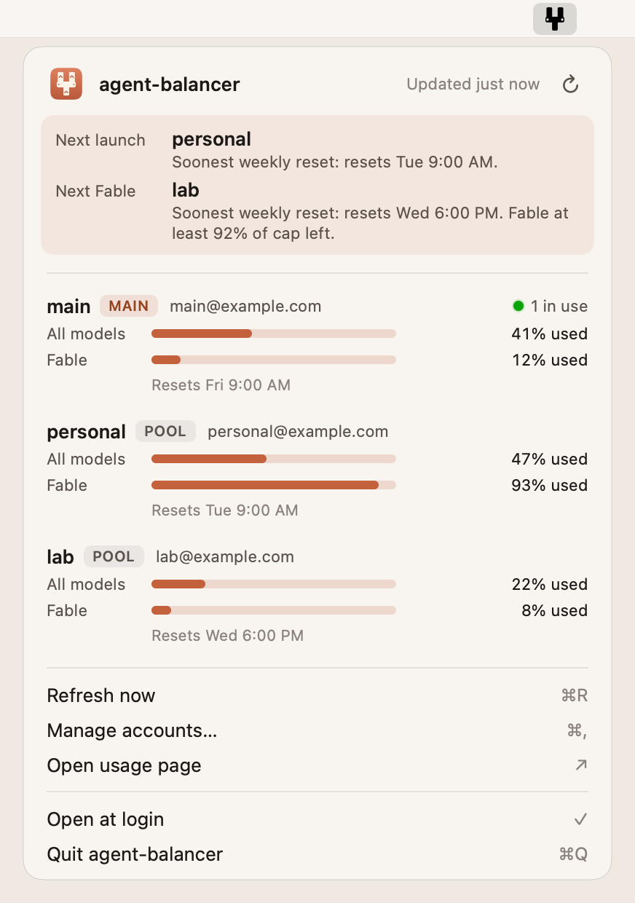

# agent-balancer

For anyone with several Claude Code accounts or subscriptions who runs into five-hour or weekly usage limits: agent-balancer reads each account's usage and picks the account for your next launch.

<div align="center">
<picture>
  <source media="(prefers-color-scheme: dark)" srcset="docs/media/hero-dark.png">
  
</picture>

*The menu with three made-up accounts.*

</div>

## How it works

- `agent-balancer refresh` reads each account's usage with a one-turn probe.
- `agent-balancer pick` chooses the account whose unused room resets soonest, with a reserve on your
  main account.
- The menu bar app shows the same state.

## Quick start

You need macOS 14 or later on Apple silicon, the GitHub CLI (signed in for the check), Claude Code
signed in and two or more Claude accounts.

1. Install the tool, download `AgentBalancerBar.zip` and check it:

   ```
   brew install jakemismas/tap/agent-balancer
   gh release download --repo jakemismas/agent-balancer --pattern AgentBalancerBar.zip
   gh attestation verify AgentBalancerBar.zip --repo jakemismas/agent-balancer
   ```

2. Unzip it and drag `AgentBalancerBar.app` to Applications; as it is not notarized, its first open
   takes [four steps](docs/GUIDE.md#install).
3. Register the signed-in account, then the others;
   `agent-balancer login <label>` opens the browser to approve as that account.

   ```
   agent-balancer init --label main
   agent-balancer add personal
   agent-balancer login personal
   agent-balancer add lab
   agent-balancer login lab
   agent-balancer config set-main main
   agent-balancer refresh
   ```

4. For the pictured accounts, `agent-balancer status --cached` prints:

   ```text
   $ agent-balancer status --cached
   main [login, main] ok week 41.0% 5h 18.0% resets Fri 9:00 AM in use 1
   personal [token, pool] ok week 47.0% 5h 9.0% resets Tue 9:00 AM in use 0
   lab [token, pool] ok week 22.0% 5h 4.0% resets Wed 6:00 PM in use 0
   next: personal
   next for fable: lab
   ```

5. Launch with `agent-balancer run <label>`, or link the skill for Claude's launches:

   ```
   mkdir -p ~/.claude/skills && ln -s "$(brew --prefix)/share/agent-balancer/skill/agent-balancer" ~/.claude/skills/agent-balancer
   ```

Upgrade with `brew upgrade agent-balancer` and the new zip; the [guide](docs/GUIDE.md) has the rest.

## The app

<div align="center">
<picture>
  <source media="(prefers-color-scheme: dark)" srcset="docs/media/manage-tokens-dark.png">
  
</picture>

*Manage accounts shows the `agent-balancer` command behind each change.*

</div>

<div align="center">
<picture>
  <source media="(prefers-color-scheme: dark)" srcset="docs/media/manage-folders-dark.png">
  
</picture>

*A folder account: its own folder, linked to your shared settings.*

</div>

<div align="center">
<picture>
  <source media="(prefers-color-scheme: dark)" srcset="docs/media/menu-dark.png">
  
</picture>

*A weekly limit and a rejected sign-in: the pick skips both.*

</div>

## For scripts and orchestrators

Call `agent-balancer pick --json` before each launch: see
[docs/ORCHESTRATORS.md](docs/ORCHESTRATORS.md) and [docs/CONTRACT.md](docs/CONTRACT.md).

## FAQ

**How do I use several Claude Code subscriptions on one Mac?** Add each account once, then launch
through `agent-balancer run <label>`.

**What happens at a five-hour or weekly usage limit?** The pick skips the account until its window
resets.

**How does it switch accounts?** A token account uses a setup-token from `claude setup-token`; a
folder account, its own CLAUDE_CONFIG_DIR.

**Does it read my Claude login?** No, nor the Keychain or the credential files; it makes no
network calls of its own.

## Details

- The tool looks for `claude` only at `~/.local/bin/claude`, `/opt/homebrew/bin/claude` and
  `/usr/local/bin/claude`, never at a path from its own files. If yours is elsewhere, link it into
  `~/.local/bin`. That file, and `~/.local/bin` if used, must be owned by you or root and not
  writable by group or others, access lists included.
- Its files are mode 0600 and its folders are mode 0700.
- To uninstall, run `agent-balancer uninstall`, drag the app to the Trash, then
  `brew uninstall agent-balancer`.

## Contributing

See [CONTRIBUTING.md](CONTRIBUTING.md) and the [code of conduct](CODE_OF_CONDUCT.md); report
vulnerabilities as [SECURITY.md](SECURITY.md) describes.

## License

[MIT](LICENSE).

> agent-balancer is an independent project. It has no affiliation with Anthropic, and Anthropic does not endorse it. Claude and Claude Code are products of Anthropic.
